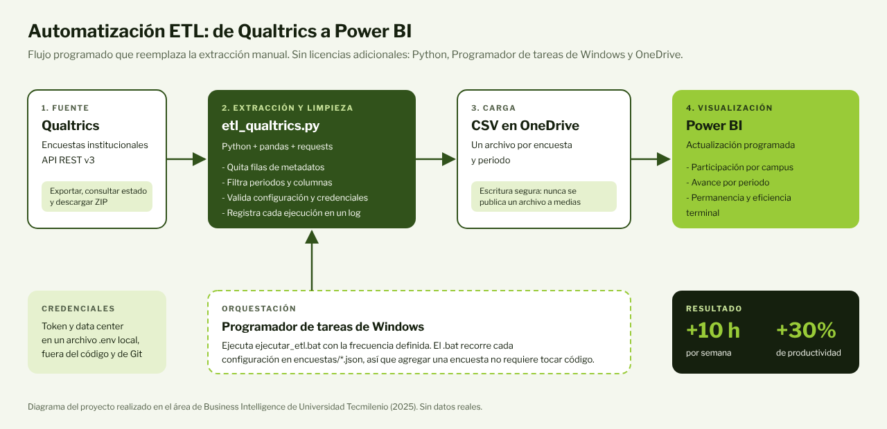

# Qualtrics ETL Automation

**An automation that extracts Qualtrics surveys, cleans them and gets them ready for Power BI, with no manual work.**



## The problem

In a university's Business Intelligence department, survey responses were downloaded manually from Qualtrics, cleaned in spreadsheets and copied into the folder that fed the Power BI dashboards. This caused three problems:

- **More than 10 hours per week** of manual extraction and cleaning.
- **Multiple versions of the same file** in circulation, with no standard to guarantee data integrity.
- Dashboards that updated late because they depended on someone doing the download.

## The solution

A Python ETL process, with no licensing costs, that:

1. **Extracts** the responses through the Qualtrics REST API (asynchronous export: start, check status and download the ZIP).
2. **Transforms** the CSV: removes the Qualtrics metadata rows, filters by period and keeps only the required columns.
3. **Loads** one CSV per survey into a OneDrive folder, from which Power BI refreshes the dashboards.
4. **Runs on its own** with Windows Task Scheduler. Each survey is defined in a JSON file, so adding a new one does not require changing the code.

## Results

| Metric | Result |
| --- | --- |
| Extraction and cleaning time | **10+ hours saved per week** |
| Team productivity on survey reporting | **+30%** |
| Licensing cost | **$0** (Python, Task Scheduler and OneDrive) |
| Dashboards fed | Institutional survey participation, inquiry survey and the redesign of a historical metrics dashboard |

## Structure

```
etl_qualtrics.py          Main script (extraction, transformation and loading)
ejecutar_etl.bat          Runs the ETL for each survey; called by Task Scheduler
encuestas/                One .json configuration per survey
  ejemplos/               Configuration templates
.env.example              Credentials template (the real .env is never committed)
tests/test_etl.py         Offline tests with a mocked API
ejemplos/                 Sample output CSV (fictitious data)
docs/                     Architecture diagram and dashboard replicas
```

## Installation

Requirements: Windows, Python 3.10 or later and the OneDrive folder synced on the computer.

```bash
git clone https://github.com/AlanDelAngel/qualtrics-etl-automation.git
cd qualtrics-etl-automation
pip install -r requirements.txt
```

> If the computer has more than one Python version, run `where python` in the terminal to find the one to use, and install the dependencies with that same version.

### 1. Credentials

Copy `.env.example` to `.env` and fill in your values:

```env
QUALTRICS_API_TOKEN=your_token
QUALTRICS_DATA_CENTER=your_data_center
```

The token is in Qualtrics under **Account Settings > Qualtrics IDs**. The data center is the first part of your account URL.

### 2. Configure a survey

Copy a template from `encuestas/ejemplos/` into `encuestas/` and edit it:

```json
{
  "survey_id": "SV_XXXXXXXXXXXXXXX",
  "nombre_csv": "participacion",
  "carpeta_salida": "C:\\Users\\YOUR_USER\\OneDrive\\Data\\Surveys",
  "columna_periodo": "Periodo",
  "periodos": ["2025 Ene - May", "2025 Ago - Dic"],
  "columnas": ["ResponseId", "EndDate", "Periodo", "Campus", "Q1", "Q2"]
}
```

| Field | Required | Description |
| --- | --- | --- |
| `survey_id` | Yes | Qualtrics survey ID (starts with `SV_`) |
| `nombre_csv` | Yes | Output file name; use a different one for each survey |
| `carpeta_salida` | Yes | Local folder (for example, the OneDrive folder that Power BI reads) |
| `columna_periodo` | No | Column used to filter periods (defaults to `Periodo`) |
| `periodos` | No | Periods to keep, written exactly as they appear in Qualtrics. Empty list = all |
| `columnas` | No | Column IDs to keep. Empty list = all |
| `conservar_fila_preguntas` | No | `true` to keep the row with each question's text |

### 3. Run

```bash
python etl_qualtrics.py --config encuestas/participacion.json
```

Or run `ejecutar_etl.bat`, which processes every survey in the `encuestas/` folder. Each run is logged in `logs/etl.log`.

### 4. Schedule automatic runs

1. Press `Win + R`, type `taskschd.msc` and open **Create Basic Task**.
2. Give it a unique name and choose the frequency (the task only runs while the computer is on).
3. Under **Action**, choose **Start a program** and select `ejecutar_etl.bat`.
4. In the **Settings** tab, enable *Allow task to be run on demand*, *Run task as soon as possible after a scheduled start is missed* and *Stop the task if it runs longer than 2 hours*.
5. Make sure OneDrive starts with Windows so the files stay in sync.

## Error handling

The ETL stops with a clear message, and **without overwriting the previous CSV**, when:

- credentials are missing, or the configuration has empty fields or invalid JSON;
- a column in `columnas` or the `columna_periodo` does not exist in the survey;
- Qualtrics rejects the request, fails to generate the file or takes longer than 15 minutes.

Filters are case, space and accent sensitive: periods and columns must be written exactly as they appear in Qualtrics. If no records match the periods, an empty CSV is generated and a warning is logged.

## Tests

The tests mock the Qualtrics API with a ZIP of fictitious data, so they need no connection or credentials:

```bash
pip install -r requirements-dev.txt
pytest
```

## Next steps

- A simple interface so users without programming knowledge can configure and run extractions.
- Migrate the survey repositories to a Data Warehouse with cloud pipelines, as a single source of truth.

## Author

**Alan Adelfo Del Angel Figueroa**, built in the Business Intelligence department of Universidad Tecmilenio (2025). Published with permission, without any institutional data or configuration.

[github.com/AlanDelAngel](https://github.com/AlanDelAngel)

---

### Resumen en español

ETL en Python que exporta respuestas de encuestas desde la API REST de Qualtrics, quita las filas de metadatos, filtra por periodo y columnas, y genera un CSV por encuesta en una carpeta de OneDrive que alimenta tableros de Power BI. Se ejecuta solo con el Programador de tareas de Windows, guarda las credenciales en un `.env` local, define cada encuesta en un archivo JSON, registra cada ejecución e incluye pruebas sin conexión con una API simulada. En producción ahorró **más de 10 horas por semana** de extracción y limpieza manual y aumentó **30%** la productividad del equipo en reportes, sin costo de licencias.
